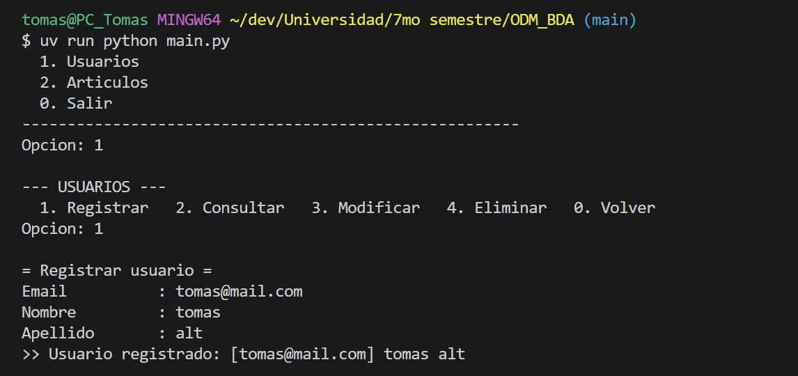
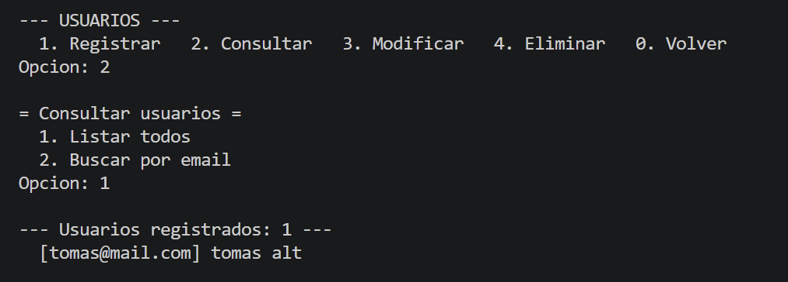
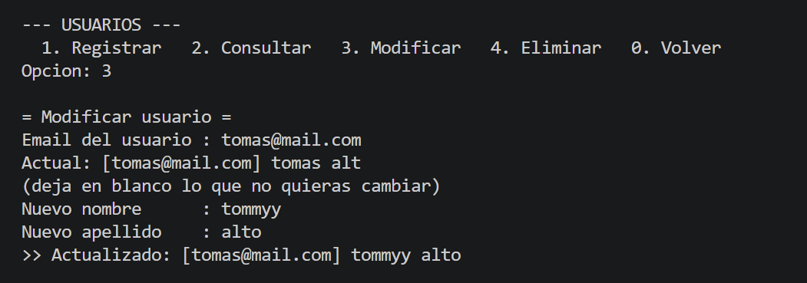
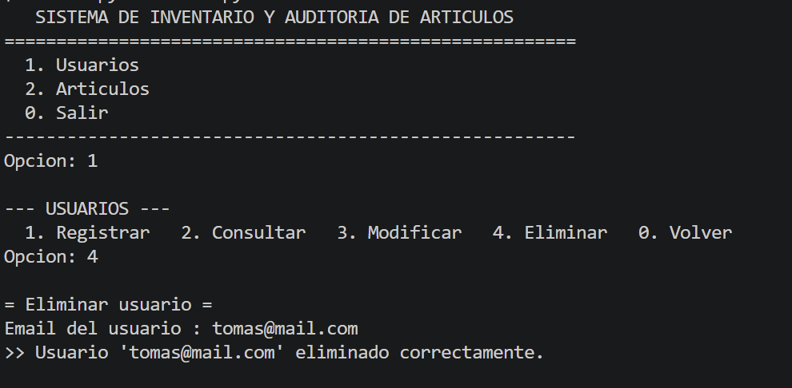
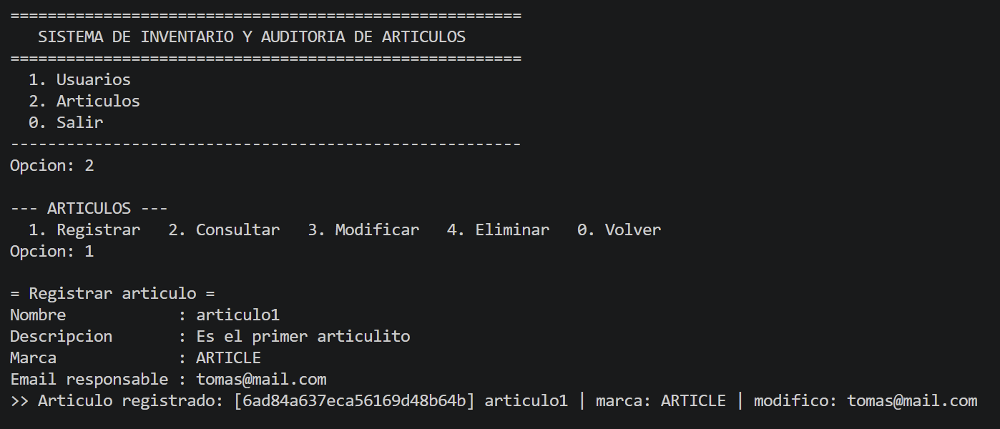
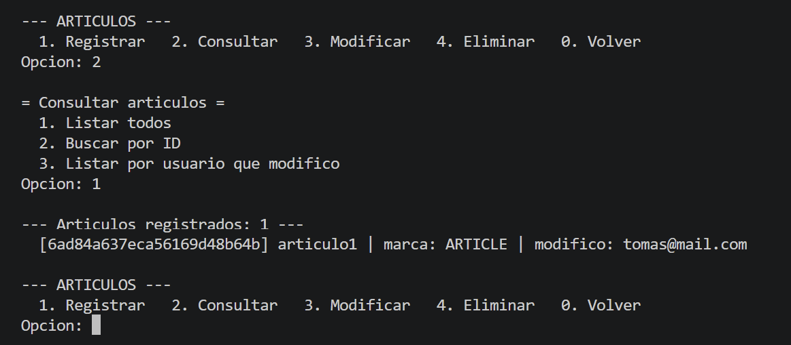
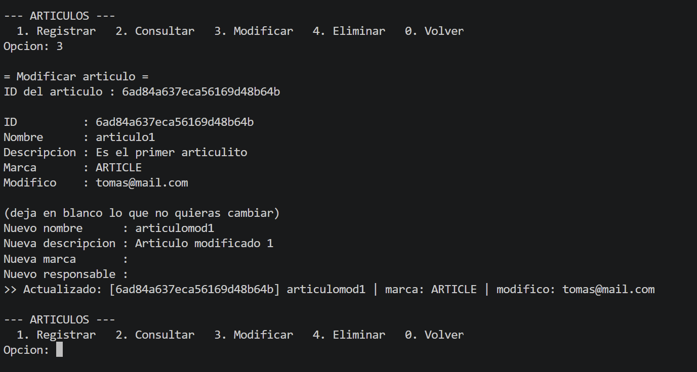
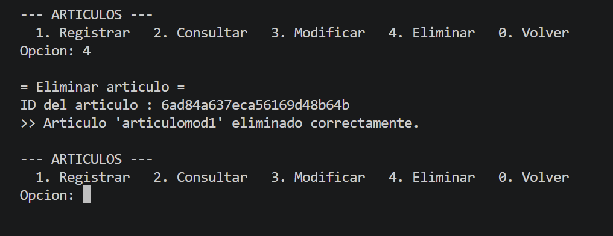
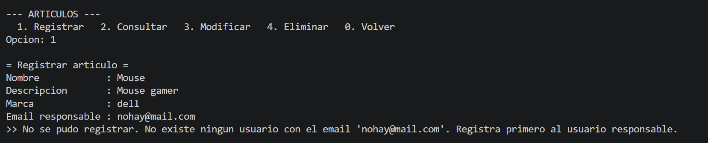
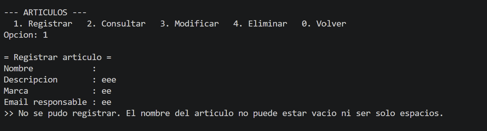

# M2.01 — Sistema de Inventario y Auditoría de Artículos

Aplicación de consola en Python que gestiona usuarios y artículos sobre MongoDB,
registrando qué usuario realizó la última modificación de cada artículo.

**Bases de Datos Avanzadas — Universidad Anáhuac**

---

## Requisitos

- Python 3.13 o superior
- MongoDB en ejecución en `localhost:27017`
- [`uv`](https://docs.astral.sh/uv/) como gestor de dependencias

## Puesta en marcha

```bash
git clone https://github.com/tomas-altamiranot/ODM_BDA.git
cd ODM_BDA
uv sync
uv run python main.py
```

`uv sync` lee el archivo `uv.lock` y reconstruye el entorno con las versiones
exactas con las que se desarrolló el proyecto, por lo que no hay diferencias
entre las máquinas de los integrantes.

Si MongoDB corre en otra dirección, se puede indicar sin tocar el código:

```bash
set MONGO_URI=mongodb://otro-host:27017/     # Windows
export MONGO_URI=mongodb://otro-host:27017/  # Linux / macOS
```

---

## 1. Organización del código

El proyecto está dividido en tres capas. Cada módulo tiene una única
responsabilidad y solo conoce a la capa que está inmediatamente por debajo.

```
ODM_BDA/
│
├── main.py                      ← punto de entrada
│
├── menus.py                     ← CAPA DE INTERFAZ
│                                   dibuja menús, lee el teclado, muestra
│                                   resultados. No sabe nada de MongoDB.
│
├── CRUD_user/
│   └── crud_usuario.py          ← CAPA DE LÓGICA DE NEGOCIO
├── CRUD_art/                        valida reglas y ejecuta operaciones.
│   └── crud_art.py                  No imprime nada en pantalla.
│
├── modelos.py                   ← CAPA DE PERSISTENCIA
└── conexion.py                      define las entidades y la conexión.
```

### Flujo de una operación

```
usuario teclea  →  menus.py  →  crud_*.py  →  modelos.py  →  MongoDB
                      ↑                           │
                      └──── (éxito, dato)  ───────┘
                            (False, mensaje)
```

### Por qué esta división

**La capa de interfaz no toca la base.** `menus.py` solo pregunta y muestra.
Si en el futuro se reemplazara la consola por una interfaz web, se descartaría
ese archivo y el resto seguiría funcionando igual.

**La capa de negocio no imprime.** Cada función devuelve una tupla
`(éxito, resultado)`: `(True, documento)` cuando la operación se completa y
`(False, "mensaje explicativo")` cuando falla. Quien decide cómo mostrar ese
mensaje es la interfaz. Esto permite probar la lógica sin simular el teclado,
y es lo que hizo posible verificar los doce casos de la sección 4.

**Las validaciones viven en la capa de negocio, no en los menús.** Si se
agregara otra forma de crear artículos (una importación masiva, por ejemplo),
seguiría pasando por las mismas reglas sin duplicarlas.

**La división permitió trabajar en paralelo.** Al estar cada responsabilidad en
su archivo, dos personas pueden editar módulos distintos sin provocar
conflictos al integrar los cambios en el repositorio.

---

## 2. Justificación del almacenamiento: MongoDB

Se eligió **MongoDB** con el ODM **MongoEngine**.

### Ventajas para este caso

- **Esquema flexible.** Un inventario real contiene artículos muy distintos
  entre sí. MongoDB no obliga a que todos los documentos de una colección
  tengan los mismos campos, así que ampliar el catálogo no requiere migrar
  la base.
- **Correspondencia directa con los objetos.** Un documento de MongoDB es
  prácticamente un objeto de Python. MongoEngine traduce entre ambos mundos
  de forma automática, sin la fricción del mapeo objeto-relacional.
- **El ODM aporta el esquema que la base no impone.** `required=True`,
  `unique=True` y `EmailField` validan los datos desde Python. Es una decisión
  deliberada: la flexibilidad se mantiene donde conviene y se restringe donde
  el negocio lo exige.
- **Persistencia real.** A diferencia de guardar en memoria o en un archivo
  JSON, los datos sobreviven al cierre del programa y admiten varias
  conexiones simultáneas.

### Desventajas consideradas

- **No existen llaves foráneas.** MongoDB acepta sin protestar una referencia
  a un documento que no existe. Es la limitación más seria para este sistema y
  se aborda en la sección 3.
- **Sin transacciones multi-documento en configuración simple.** Una instancia
  local sin réplica no permite agrupar varias escrituras en una operación
  atómica. Para este alcance no fue necesario, pero en un sistema de inventario
  real con movimientos de stock sí lo sería.
- **Requiere un servidor.** SQLite habría evitado esa dependencia, pero el
  objetivo de la práctica era precisamente trabajar el mapeo objeto-documento.

### Alternativas descartadas

| Opción | Por qué se descartó |
|---|---|
| Memoria (listas y diccionarios) | Los datos se pierden al cerrar el programa |
| Archivo JSON | Sin índices ni unicidad; concurrencia inviable |
| SQLite | Es relacional; no permitiría practicar el ODM |

---

## 3. Estrategia de claves

Se emplean **dos niveles de identificación**, cada uno con un propósito
distinto.

### Clave técnica: `_id`

MongoDB asigna automáticamente un `ObjectId` de 12 bytes a cada documento.
Es único, inmutable y se genera sin consultar a la base.

- Es la clave primaria real de **ambas** colecciones.
- Es lo que el campo `usuario_modifico` guarda internamente.
- Identifica a los **artículos** de cara al usuario, porque su nombre puede
  repetirse legítimamente (dos registros de "Teclado Logitech" son válidos).

### Clave de negocio: `email`

El `email` identifica a los usuarios en la interfaz. Se declaró con
`unique=True`, lo que crea un índice único en MongoDB: un segundo intento de
registrar el mismo correo es rechazado por el motor, no solo por el código.

Se normaliza a minúsculas y sin espacios antes de guardarlo, de modo que
`Ana@Mail.com` y `ana@mail.com ` se consideran el mismo usuario.

**Por qué el email y no el `_id` para los usuarios:** un `ObjectId` como
`6ad848fb2724a8f62f4c742f` es imposible de teclear sin equivocarse. El email
es memorable y ya es único por naturaleza. La aplicación lo traduce
internamente al `_id` correspondiente.

### Integridad referencial

MongoDB **no valida las referencias**: aceptaría guardar un artículo apuntando
a un usuario inexistente y el dato quedaría roto en silencio. El sistema lo
resuelve en dos niveles:

**1. Verificación previa en código.** Antes de guardar o modificar un artículo,
`crud_art.py` consulta que el usuario exista. Si no, la operación se rechaza
y se explica el motivo:

```python
usuario = buscar_usuario(email_usuario)
if usuario is None:
    return False, f"No existe ningún usuario con el email '{email_usuario}'."
```

**2. Regla de borrado en el modelo.** El campo se declara con
`reverse_delete_rule=me.DENY`, que impide eliminar un usuario mientras tenga
artículos asociados:

```python
usuario_modifico = me.ReferenceField(User, reverse_delete_rule=me.DENY)
```

Se eligió `DENY` sobre las alternativas por el propósito del sistema. Con
`CASCADE`, dar de baja a un empleado borraría todo el historial de artículos
que modificó — justo la información que esta aplicación existe para conservar.
Con `NULLIFY`, los artículos quedarían sin responsable y se perdería la
trazabilidad. `DENY` obliga a reasignar los artículos antes de eliminar al
usuario, que es la decisión correcta en un sistema de auditoría.

---

## 4. Guía de pruebas y evidencia de ejecución

Todas las capturas corresponden a ejecuciones reales contra MongoDB y están en
la carpeta [`evidencias/`](evidencias/).

### Operaciones CRUD — Usuarios

| Operación | Resultado | Evidencia |
|---|---|---|
| **Create** — registrar usuario | Usuario creado con su fecha automática |  |
| **Read** — listar todos | Devuelve los usuarios ordenados por email |  |
| **Update** — modificar nombre y apellido | `tomas alt` → `tommyy alto` |  |
| **Delete** — eliminar por email | Eliminado tras liberar sus artículos |  |

### Operaciones CRUD — Artículos

| Operación | Resultado | Evidencia |
|---|---|---|
| **Create** — registrar artículo | Creado con la referencia a su responsable |  |
| **Read** — listar todos | Muestra el email del usuario que lo modificó |  |
| **Update** — modificar por ID | Cambia nombre y descripción; la marca en blanco conserva su valor |  |
| **Delete** — eliminar por ID | Eliminado correctamente |  |

### Casos de fallo controlado

Ninguno interrumpe la ejecución: el programa explica el motivo y vuelve al menú.

**A. Artículo asociado a un usuario inexistente**

Es la prueba de la integridad referencial implementada en código. MongoDB
habría aceptado la referencia sin protestar; la validación previa lo impide.



```
>> No se pudo registrar. No existe ningun usuario con el email
   'nohay@mail.com'. Registra primero al usuario responsable.
```

**B. Artículo con nombre vacío**

El nombre se compone únicamente de espacios. Para Python no es una cadena
vacía, pero `.strip()` lo detecta antes de llegar a la base.



```
>> No se pudo registrar. El nombre del articulo no puede estar vacio
   ni ser solo espacios.
```

### Otros casos verificados

Comprobados durante el desarrollo; no interrumpen la ejecución.

| Caso | Mensaje del sistema |
|---|---|
| Email de usuario duplicado | `Ya existe un usuario registrado con el email 'ana@mail.com'.` |
| Eliminar usuario con artículos asociados | `No se puede eliminar 'luis@mail.com': tiene articulos asociados.` |
| Entrada no numérica en el menú | `Opcion no valida. Elige una de: 0, 1, 2` |
| ID de artículo con formato inválido | `No existe ningun articulo con el id 'esto-no-es-un-id'.` |

---

## 5. Decisiones de diseño destacadas

**La conexión se verifica con un `ping` explícito.** `connect()` de MongoEngine
no contacta al servidor: solo registra los datos de conexión. Un `try/except`
alrededor de esa llamada no detectaría un servidor caído. Por eso `conexion.py`
envía un comando `ping`, que sí viaja por la red, y así el fallo se reporta al
arrancar en lugar de aparecer más tarde en la primera operación.

**La fecha de creación se pasa como función, no como valor.** El campo se
declara con `default=_ahora_utc` (sin paréntesis). Pasar
`default=datetime.now(...)` ejecutaría la llamada una sola vez, al importar el
módulo, y todos los usuarios compartirían la misma marca de tiempo.

**Las cadenas se normalizan con `.strip()` antes de validar.** Un nombre de
`"   "` no es vacío para Python, pero sí lo es para el negocio.

**Los campos en blanco al modificar significan "no cambiar".** Permite corregir
un solo dato sin volver a teclear los demás.

---

## Integrantes

- Tomás Altamirano
- Oswaldo Lucio
- Stephanie Bayona
- Isaac Padilla